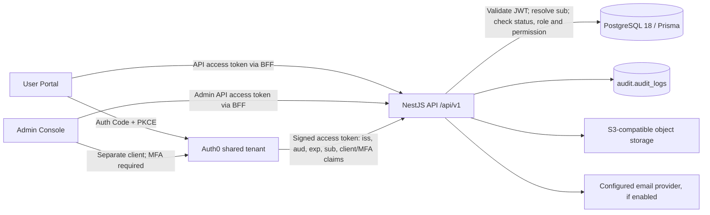

# Examinity Module 1 — Client Overview

Audience: client technical reviewers, application engineers, security, database and operations teams
Revision: 1.0 · Date: 4 November 2026 · Status: implementation overview for technical review

## Contents

- [1. Executive summary](#1-executive-summary)
- [2. Scope and system boundaries](#2-scope-and-system-boundaries)
- [3. Architecture](#3-architecture)
- [4. Request and identity flow](#4-request-and-identity-flow)
- [5. Module capabilities and flows](#5-module-capabilities-and-flows)
- [6. Data and persistence](#6-data-and-persistence)
- [7. API conventions and security controls](#7-api-conventions-and-security-controls)
- [8. Deployment and operational handoff](#8-deployment-and-operational-handoff)
- [9. Review decisions and remaining acceptance items](#9-review-decisions-and-remaining-acceptance-items)
- [10. Source references](#10-source-references)

## 1. Executive summary

Module 1 is the shared identity and platform foundation for Examinity. It provides Auth0-backed identity resolution, local user profiles, server-side role-based authorization, user account lifecycle, sessions for Examinity API tokens, audit history, configuration, feature flags, a permission-filtered landing summary and media metadata/presigned transfer APIs.

The Admin Console is a separate frontend experience that reuses the same Auth0 tenant and the same Examinity user, role, permission, session and audit records. A distinct Auth0 Admin application and MFA policy identify privileged sign-ins. The backend remains the authorization authority: successful Auth0 login alone does not grant Admin access.

The current backend publishes 70 operations in its running OpenAPI document. See the API reference for request inputs, access rules, success statuses and response contract notes. The Prisma schema and migration history are the database source of truth.

## 2. Scope and system boundaries

### In this backend

- Shared Auth0 subject to internal user mapping, user sync and current-user identity.

- User account/profile and email-preference records, verification state and Terms acceptance.

- Role catalogue, permission catalogue, role mappings, user role assignments and effective permission checks.

- Admin screen APIs for dashboard, users, account lifecycle, role management, audit search, settings, feature flags and own API sessions.

- User landing summary, self-service profile/preferences and own API sessions.

- Append-only application audit events, API token-session revocation, media metadata/upload URL lifecycle and health probes.

### Outside this backend boundary

- Browser login redirects, Auth0 callback, browser/BFF cookies and Auth0 SSO logout: owned by the separate frontend/BFF.

- Password and OTP verification: Auth0 owns authentication and verification. The API receives a validated API access token; it does not store passwords.

- Exam/course/content authoring, exam attempts, scoring and analytics: not part of this Module 1 platform foundation.

- Production tenant, database, mail sender, storage credentials, DNS/TLS and hosting account: supplied/configured by the project owner and operations team.

## 3. Architecture

The API is a NestJS modular monolith using PostgreSQL 18 and Prisma 7. It exposes REST under /api/v1; /health/live and /health/ready are outside that prefix. Pino request logging, Helmet, CORS, rate limiting, validation, response wrapping and safe error handling are configured at application level. No Redis or BullMQ service is required by this implementation.

The Admin and User frontends are separate application experiences. They share one Auth0 tenant per environment and one Examinity API. Development and production must use separate Auth0 tenants. The Admin client uses its own client ID/callback configuration and requires MFA. There is no public Admin signup.

## 4. Request and identity flow

1. The user or administrator signs in through Auth0 Universal Login in the appropriate frontend application. The Admin flow requires MFA through the Admin application policy.

2. The frontend/BFF presents an Auth0 API access token to the API in Authorization: Bearer .... An ID token is not an API credential.

3. Auth0Guard verifies the token signature, issuer, audience, expiry and required claims. For Admin application access, the Admin client and MFA context are checked by the Admin access policy.

4. The stable Auth0 sub resolves to the internal identity.users.id. Email/phone matching is not used to link separate Auth0 subjects.

5. Application status, verification state, current role assignments and permission codes are checked server-side. Disabled, suspended, locked or unverified principals are denied according to route policy.

6. The service performs its database work. Sensitive mutations write the state change and audit event transactionally where implemented.

7. A successful response is wrapped as { "data": ..., "meta": { "request_id": "..." } }; paginated routes add pagination fields in meta. Failures use the standard error envelope described in the API reference.

### First-time user provisioning

POST /api/v1/auth/sync resolves the Auth0 identity and, on first provisioning, requires explicit Terms acceptance, terms version and registration source. A verified identity can become active and receive the standard AUTHENTICATED_USER role. An unverified identity remains pending and receives no roles until verification and a subsequent sync. Repeated sync is based on Auth0 sub; login never silently reactivates a disabled or suspended application account.

## 5. Module capabilities and flows

### User experience

- GET /auth/me returns the current identity and effective roles/permissions.

- GET /dashboard returns the signed-in user's landing summary and navigation hints. Navigation is informational; each API independently authorizes requests.

- GET/PATCH /users/:id and /users/:id/preferences allow the authenticated user to manage their own approved profile fields and notification preferences. Ownership is enforced by the service.

- GET/DELETE /auth/me/sessions... supports the signed-in user's Examinity API-token sessions.

- POST /auth/logout revokes the API token session and records logout; the client separately ends its browser/BFF and Auth0 sessions.

### Admin user and account lifecycle

Admin user search/detail reads use the shared user records. Status, lock/unlock and reinstatement are controlled operations with server-side permissions and audit evidence. LOCKED is an application account state; it is distinct from Auth0 brute-force protection. Reinstatement requires a reason; restricted SECURITY, FRAUD, LEGAL or INVESTIGATION suspensions require SUPER_ADMIN approval for the two-person workflow. Suspension does not imply that an Auth0 identity has been blocked.

### Roles and permissions

identity.roles, identity.permissions, identity.role_permissions and identity.user_role_assignments are shared by Admin and user flows. ADMIN gets only its configured baseline permissions. AUTHENTICATED_USER has no administrative permissions. SUPER_ADMIN is protected and provisioned through a controlled bootstrap, not public registration. Role assignment/revocation and permission-map writes are permission-gated and audited; system-role mappings are protected.

### Sessions

The API creates an identity.api_sessions record when a validated bearer token first uses the API. It stores a token fingerprint, not the bearer token. Each subsequent protected request checks revocation. “Revoke session” invalidates future Examinity API calls with that token. It does not revoke an Auth0 refresh token, end Auth0 SSO, or clear the frontend/BFF cookie. Only sessions that have called this API are known to the session list.

### Platform settings and feature flags

Settings are an allowlisted catalogue. Sensitive values are redacted; actual credentials belong in a secrets manager/environment configuration. Writes require expected_version and a reason, validate against backend-owned rules, increment the version and are audited. Feature flags persist enabled, status and version; inactive definitions evaluate as disabled. The backend, not the browser, is the final validator.

### Media

The API validates upload metadata and idempotency key, creates a pending media record, returns a short-lived presigned upload URL, validates completion and issues short-lived download URLs after ownership/visibility checks. Production needs configured S3-compatible storage; local mock behavior does not prove real object-storage integration. Soft deletion marks metadata; physical object cleanup is operational lifecycle work.

## 6. Data and persistence

PostgreSQL is organized into schemas identity, platform, audit, media and notification. The diagram in Module workflows and ER model shows the main tables and foreign-key relationships. Principal mapping:

| **Business area** | **Persisted records**                                          | **Notes**                                                                                           |
| ----------------- | -------------------------------------------------------------- | --------------------------------------------------------------------------------------------------- |
| Identity          | identity.users, user_profiles, terms_acceptances, api_sessions | Auth0 sub maps to users.auth0_subject; internal UUID is used in application APIs.                   |
| RBAC              | roles, permissions, role_permissions, user_role_assignments    | One source of truth; no separate Admin RBAC schema.                                                 |
| Platform          | platform.configurations, feature_flags, idempotency_keys       | Allowlisted, versioned configuration; idempotency state.                                            |
| Audit             | audit.audit_logs                                               | Central append-only action history; no parallel Admin audit subsystem.                              |
| Media             | media.media_assets                                             | Metadata and ownership; binary objects live in configured external storage.                         |
| Notifications     | notification.email_preferences, email_templates                | Preference/template persistence; sending requires a configured provider.                            |
| Provider delivery | identity.phone_otp_delivery_attempts                           | Stores hashed recipient and encrypted transient delivery metadata; not an OTP authentication store. |

Apply schema only through committed Prisma migrations (pnpm db:deploy); seed through pnpm db:seed. Do not hand-create or separately migrate Admin tables. Backups, retention, restore testing and database access controls are production operations responsibilities.

## 7. API conventions and security controls

- Base route: /api/v1; bearer authentication is required except health probes and the provider callback's separate provider-secret guard.

- Admin operations use named admin.* permissions evaluated from PostgreSQL. Admin route access additionally requires configured Admin-client/MFA claims.

- DTO validation rejects unknown properties and validates path UUIDs, enum values, required fields and bounds.

- List APIs use bounded pagination (page, page_size; maximum page size 100 where applicable).

- Sensitive write routes require a reason; settings/flags use optimistic locking with expected_version.

- Media presign requires Idempotency-Key.

- Errors do not reveal SQL, secrets, tokens or stack traces. Typical codes include validation_error, authorization failures, version conflicts and internal_server_error; see endpoint behavior and error envelope in the API reference.

- Use TLS in production, strict allowed CORS origins, protected environment secrets and a verified deployment artifact. Never export populated Postman environments or commit tokens/secrets.

## 8. Deployment and operational handoff

The repository includes Hostinger deployment guidance. The API readiness check requires a valid Auth0 issuer/audience configuration and database connectivity. Before production traffic: apply migrations, seed reviewed catalogues, provision the controlled first SUPER_ADMIN, configure separate production Auth0 tenant/API/Admin client/MFA claims, restrict database/network access, configure HTTPS/CORS, and verify health endpoints.

Optional integrations are conditional: email requires a configured approved sender/provider; media requires S3-compatible credentials; phone provider callback requires its provider secret and delivery configuration. A local mock issuer is loopback-only development/test support and is not an identity provider for a deployed public environment.

## 9. Review decisions and remaining acceptance items

1. D9 permission catalogue reconciliation: the client decision says reuse Module 1 permission codes where semantically equivalent and create new admin.* codes only when approved. The current code seeds Admin codes and has documented candidate overlaps with legacy generic permissions. The Module 1/API owner must approve the mapping and deployment migration/role grants; review Admin RBAC permission mapping. This is a release acceptance item.

2. Admin Auth0 tenant setup: verify the Admin application ID, MFA Action, namespaced claims, issuer/audience and environment values in each target tenant. Local mock fixtures only test backend claim enforcement.

3. Auth0 attack protection: application LOCK/UNLOCK invalidates Examinity API tokens; it does not automatically clear or synchronize Auth0 brute-force protection. Agree the operational synchronization and recovery process.

4. Production integrations and operations: provide target database/backup/restore owner, production secrets, monitoring/retention, email sender and object storage configuration when in scope. The Hostinger guide notes deployment pipeline and production variables that remain owner/DevOps inputs.

5. Scope confirmation: phone-provider/WhatsApp fallback is not the same as Auth0 phone verification. Confirm that provider callback use is approved before enabling it in a tenant; the callback is separately guarded and audited.

These are environment/owner acceptance matters; the API implementation documents must not imply they have been verified by the local mock demo.

## 10. Source references

- src/ controllers, guards, services and global response/error handling.

- prisma/schema.prisma and prisma/migrations/.

- Running /api/docs-json snapshot used for the API reference.

- Supplied Admin Developer Queries, Admin Design Guideline/Workflow, Admin Database/API schema and Module 1 specification PDFs.

- Repository Admin screen/API matrix, Admin contract, RBAC mapping, session implementation notes and Postman runbooks.
