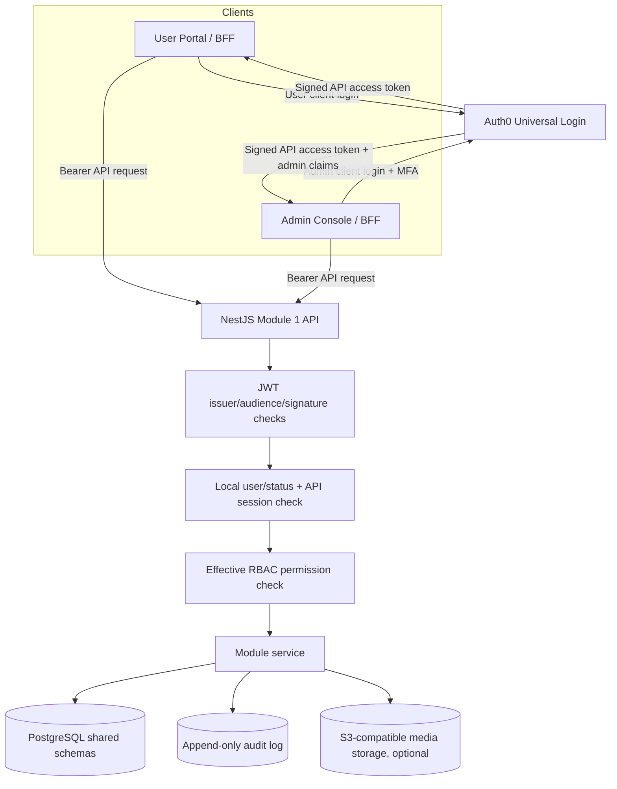
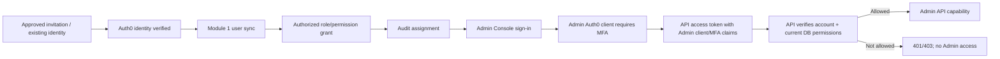
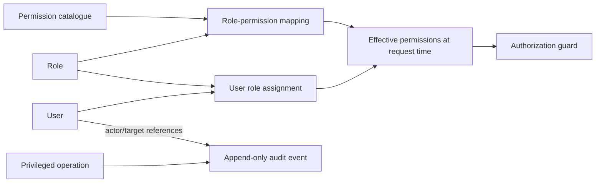
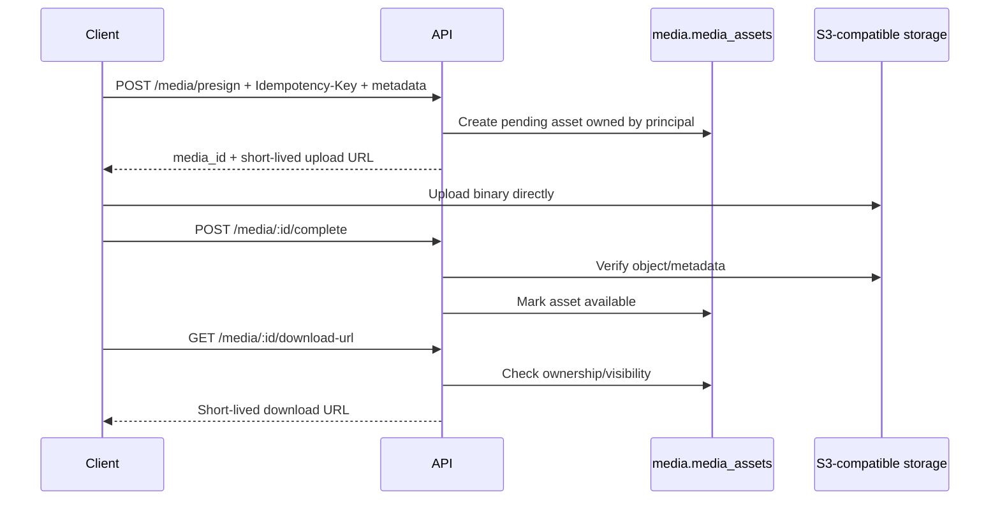
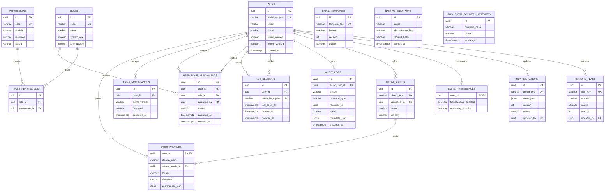

# Examinity Module 1 — Workflows and Data Model

Audience: client technical reviewers, backend/frontend engineers, data and security teams
Revision: 1.0 · Date: 4 November 2026 · Status: implementation workflow and logical ER reference

## Contents

- [1. System overview](#1-system-overview)
- [2. Identity and onboarding](#2-identity-and-onboarding)
- [3. API request authorization](#3-api-request-authorization)
- [4. Admin provisioning and access](#4-admin-provisioning-and-access)
- [5. Account lifecycle and reinstatement](#5-account-lifecycle-and-reinstatement)
- [6. RBAC and audit](#6-rbac-and-audit)
- [7. API session lifecycle](#7-api-session-lifecycle)
- [8. Settings, flags and media](#8-settings-flags-and-media)
- [9. Logical ER diagram](#9-logical-er-diagram)
- [10. Table and relationship catalogue](#10-table-and-relationship-catalogue)
- [11. Data lifecycle and transaction notes](#11-data-lifecycle-and-transaction-notes)
- [12. Implementation limits and review decisions](#12-implementation-limits-and-review-decisions)
- [Source references](#source-references)

## 1. System overview

The User Portal and Admin Console are separate clients. Both use the shared Auth0 tenant for a given environment and call one Examinity API. The Admin Console uses a distinct Auth0 application registration with mandatory MFA. Auth0 authenticates; the Examinity backend decides account eligibility, role assignments and permissions.



## 2. Identity and onboarding

```mermaid
sequenceDiagram
participant Person as User or Admin
participant Client as Portal/Admin BFF
participant Auth0
participant API as Examinity API
participant DB as PostgreSQL
Person->>Client: Start sign-in
Client->>Auth0: Authorization Code + PKCE
Auth0->>Person: Authenticate; Admin client additionally challenges MFA
Auth0-->>Client: Authenticated client session
Client->>API: Bearer API access token
API->>API: Validate signature, issuer, audience, expiry, claims
API->>DB: Resolve Auth0 sub to identity.users.auth0_subject
alt First local provisioning
Client->>API: POST /api/v1/auth/sync with Terms acceptance
API->>DB: Create user/profile and Terms record
else Existing identity
API->>DB: Check status, verification, sessions and current permissions
end
API-->>Client: Standard data/meta response or safe error
```

On first sync, explicit accepted terms, current terms version and registration source are required. A verified identity becomes eligible for the standard authenticated-user role. An unverified identity remains pending with no roles. The backend links by Auth0 sub, not by matching email or mobile number. Sync does not reactivate a disabled or suspended user.

Admin provisioning is controlled: the user identity already exists or is invited through approved onboarding, then a privileged operator assigns approved Admin permissions/role through backend controls. Initial SUPER_ADMIN assignment uses a guarded bootstrap process. There is no public Admin registration route.

## 3. API request authorization

1. Client/BFF calls /api/v1/... with an Auth0 API access token. Public health endpoints do not require a bearer token. The phone-provider callback uses a separate provider-secret guard.

2. JWT guard validates cryptographic and standard claims; ID tokens are not accepted as API tokens.

3. Internal identity is resolved using sub. Account status, verification and lock/revocation policy are checked.

4. Admin endpoints enforce the Admin client/MFA context and server-side permission codes. Route aliasing does not bypass the same service/guards.

5. Ownership/self-service checks are enforced by the service using the verified principal, never a caller-supplied user ID as authority.

6. The service reads/writes PostgreSQL. Sensitive writes record before/after context and reason in audit.audit_logs, in the same transaction where the implementation requires atomicity.

7. Response interceptor adds data and meta.request_id; exception filter returns a safe error envelope.

## 4. Admin provisioning and access



An authenticated regular user without Admin permissions remains a regular user. Role codes in the browser/token are not the source of truth for authorization; PostgreSQL assignments are evaluated on requests. The seeded initial roles are SUPER_ADMIN, ADMIN and AUTHENTICATED_USER; future CONTENT_ADMIN/REVIEWER/PUBLISHER roles are excluded from initial scope.

## 5. Account lifecycle and reinstatement

```mermaid
stateDiagram-v2
[*] --> PENDING: First sync; identity not verified
[*] --> ACTIVE: First sync; identity verified + terms accepted
PENDING --> ACTIVE: Verified + later sync
ACTIVE --> DISABLED: Authorized status change
DISABLED --> ACTIVE: Authorized enable
ACTIVE --> LOCKED: Authorized lock / security policy
LOCKED --> ACTIVE: Authorized unlock or controlled expiry recovery
ACTIVE --> SUSPENDED: Authorized suspension with category + reason
SUSPENDED --> ACTIVE: Routine reinstatement with reason
SUSPENDED --> SUSPENDED: Restricted request pending / rejected
SUSPENDED --> ACTIVE: SUPER_ADMIN approval + restriction clearance
```



PENDING, ACTIVE, DISABLED, LOCKED and SUSPENDED are different states. Account status is Examinity application policy; Auth0's brute-force/attack-protection block is separate. Successful lock/unlock/reinstatement policies invalidate older Examinity API tokens where implemented. A previously revoked token is not restored by reinstatement.

For routine suspension, an authorized actor may reinstate with a mandatory reason. SECURITY, FRAUD, LEGAL and INVESTIGATION suspensions use a two-person workflow when requested by an ADMIN: the request is recorded, and a SUPER_ADMIN approves with clearance reason or rejects with a reason. Self-reinstatement is denied. State transition and decision evidence are stored in the shared user/audit records, not a parallel Admin account history system.

## 6. RBAC and audit



One identity permission catalogue is shared. Role assignment, permission mapping, settings/flag writes and user lifecycle actions use backend authorization. Admin changes carry actor, target/resource, action, result, reason and before/after information where applicable. Audit records are the approved role/permission history source; do not add parallel history tables without an identified gap and architecture approval.

D9 acceptance dependency: the supplied decision says to reuse semantically equivalent Module 1 permission codes and introduce admin.* codes only when no equivalent exists and naming is approved. The current implementation seeds Admin codes. The current RBAC mapping document identifies legacy candidates and says the owner reconciliation/approval is pending. Resolve this with the Module 1 permission owner before production permission grants or migration.

## 7. API session lifecycle

```mermaid
sequenceDiagram
participant C as Client/BFF
participant API as Examinity API
participant DB as identity.api_sessions
C->>API: Request with validated API access token
API->>DB: Find/register fingerprinted API token session
API-->>C: Request response
C->>API: GET own sessions / revoke a session
API->>DB: Enforce owner from authenticated principal
API->>DB: Set revoked_at/revoked_by; audit
C->>API: Later request with revoked token
API->>DB: Detect revoked session
API-->>C: 403 session_revoked
```

Session IDs are internal UUIDs. The API stores a token fingerprint, never the bearer token itself. A session is visible after its token has called this API. Revoke-others excludes the current session. The API session feature invalidates Examinity API calls; it does not terminate Auth0 SSO, revoke refresh tokens, or clear browser/BFF cookies. The frontend must handle those separately.

## 8. Settings, flags and media

### Versioned setting/flag write

GET returns the current value/flag state and version. Authorized caller submits an update with the returned expected_version and a reason. Backend validates the allowlisted key/schema, rejects stale versions, persists the new value/status and audit event, and increments version. Inactive settings/flags remain reviewable; inactive flags evaluate false.

### Media upload/download



Production storage must be configured and access restricted. Media records hold metadata and ownership; file bytes stay in object storage. Deletion marks the record and requires a storage lifecycle/cleanup operation.

## 9. Logical ER diagram

The diagram is logical and focuses on persisted entities and foreign-key relationships. PostgreSQL schema and exact nullable/index constraints are defined by prisma/schema.prisma and committed migrations.



## 10. Table and relationship catalogue

| **PostgreSQL schema/table**          | **Responsibility and relationships**                                                                                                             |
| ------------------------------------ | ------------------------------------------------------------------------------------------------------------------------------------------------ |
| identity.users                       | Canonical Examinity identity keyed by UUID; unique Auth0 subject; status, verification, security lifecycle and actor references.                 |
| identity.user_profiles               | One-to-one profile/preferences JSON; optional avatar points to media asset.                                                                      |
| identity.terms_acceptances           | Terms version, acceptance result/time and registration source; belongs to one user.                                                              |
| identity.roles                       | Shared role catalogue; protected/system metadata.                                                                                                |
| identity.permissions                 | Shared permission definitions by module/resource/action.                                                                                         |
| identity.role_permissions            | Many-to-many role-to-permission map.                                                                                                             |
| identity.user_role_assignments       | User-to-role assignments, assigner, time window and revocation state.                                                                            |
| identity.api_sessions                | User-owned API token fingerprint and device/activity/expiry/revocation metadata; optional revoker references a user.                             |
| identity.phone_otp_delivery_attempts | Provider delivery metadata; does not make this API the OTP authority.                                                                            |
| platform.configurations              | Allowlisted versioned values and metadata; updater references user. Secrets are redacted and must be stored outside this table.                  |
| platform.feature_flags               | Registered flag value, status and optimistic-lock version; updater references user.                                                              |
| platform.idempotency_keys            | Request hash and cached response metadata, unique by scope/key.                                                                                  |
| audit.audit_logs                     | Central append-only actor/action/resource/outcome/request-context and metadata. Resource ID is an auditable reference and not a duplicate table. |
| media.media_assets                   | Object metadata and owner; object binary is external. User profile avatar may reference asset.                                                   |
| notification.email_preferences       | One-to-one user email preferences.                                                                                                               |
| notification.email_templates         | Versioned localized templates; no user foreign key.                                                                                              |

Schema names intentionally differ from labels in the supplied ER image. For example, Auth0 sub is persisted as users.auth0_subject; account_status is users.status; mobile verification is phone_verified; user roles are stored in user_role_assignments. The supplied image's Admin entities are implemented through these shared Module 1 tables, not parallel admin_* tables.

## 11. Data lifecycle and transaction notes

- Migrations are ordered and committed under prisma/migrations/. Run pnpm db:deploy against the intended database, then the idempotent catalogue seed. Review the migration target before either operation.

- Auth0 subject is the stable identity key. Email/phone can change and must not be used for implicit identity merging.

- Role assignment and account status are mutable current state; the shared audit log holds the historical actor/reason/before-after trail.

- Session revocation and protected account transitions are checked against current persisted state so subsequent API calls are blocked promptly.

- Configuration and feature flag optimistic versions prevent lost updates when two administrators edit concurrently.

- Media metadata can be soft-deleted while an object remains in storage until lifecycle cleanup.

- Configure backups, retention and restore drills before production. This repository does not certify an external database backup schedule or prove restore readiness.

## 12. Implementation limits and review decisions

- Admin API-session revocation governs Examinity API tokens only; Auth0 SSO and browser/BFF session controls are separate.

- The client-approved D9 permission equivalence/reuse mapping still requires owner sign-off before production permission migration/grants.

- Auth0 brute-force protection synchronization is separate from Examinity application LOCKED status; the operations procedure must be agreed.

- Location in session rows is best-effort/not configured; IP and User-Agent are collected subject to deployment proxy configuration.

- Provider delivery, email and S3-compatible storage need real credentials and integration checks. Local mock responses are not proof of external delivery.

- No organization/tenant scoping exists in the current schema; do not promise organization filters or boundaries.

- No user hard-delete API exists. Role assignment DELETE revokes assignment; it does not delete users or role definitions.

- The scope excludes examination-specific workflows and analytics.

## Source references

prisma/schema.prisma; prisma/migrations/; src/auth/; src/users/; src/roles/; src/sessions/; src/platform/; src/audit/; src/media/; src/dashboard/; supplied Module 1 design/implementation specification and Admin ER/API schema; supplied Admin design guidelines and Developer Queries; repository Admin API and session gap documents.
